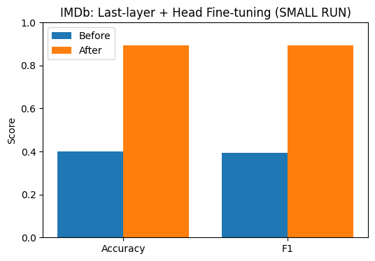
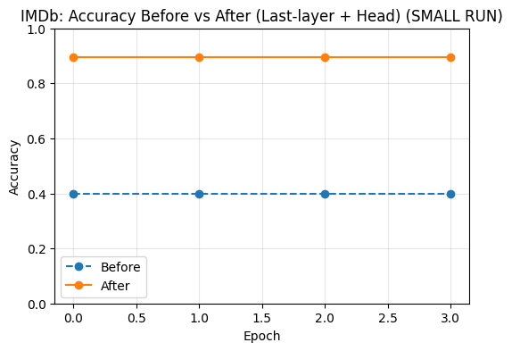

# Last-Layer + Classification-Head Fine-Tuning

**Partial fine-tuning of DistilBERT for IMDb sentiment classification.** The experiment freezes the pretrained model except for the task head and the final Transformer block, allowing the uppermost representation to adapt while leaving earlier backbone layers fixed.

<p align="center"><a href="#contents"></a> &nbsp; <a href="https://huggingface.co/"></a> &nbsp; <a href="https://huggingface.co/datasets/stanfordnlp/imdb"></a> &nbsp; <a href="https://www.python.org/"></a> &nbsp; <a href="LICENSE"></a></p>

<p align="center"><strong><a href="../README.md">Repository overview</a></strong> · <strong><a href="last_layer_fine_tuning.py">Training script</a></strong> · <strong><a href="LICENSE">MIT License</a></strong></p>

## Contents

- [1. Objective and distinction from head-only training](#1-objective-and-distinction-from-head-only-training)
- [2. Experiment configuration](#2-experiment-configuration)
- [3. Which parameters are trainable?](#3-which-parameters-are-trainable)
- [4. End-to-end workflow](#4-end-to-end-workflow)
- [5. Install and run](#5-install-and-run)
- [6. Evaluation](#6-evaluation)
- [7. Result plots](#7-result-plots)
- [8. Inference helper](#8-inference-helper)
- [9. Artifacts and directory map](#9-artifacts-and-directory-map)
- [10. Reproduction checklist](#10-reproduction-checklist)
- [Author](#author)
- [License](#license)


## 1. Objective and distinction from head-only training

Head-only fine-tuning updates only the randomly initialized classifier. This experiment additionally trains the last Transformer block. The intention is to compare a small trainable surface with a somewhat more adaptive model while still avoiding full-backbone fine-tuning.

The tracked script is `last_layer_fine_tuning.py`, exported from a Colab notebook. It defaults to `distilbert-base-uncased`, but contains selector branches for DistilBERT, BERT, RoBERTa/XLM-R, and a fallback for common base-model encoder layouts.

## 2. Experiment configuration

| Component | Configuration in the script |
|---|---|
| Default checkpoint | `distilbert-base-uncased` |
| Dataset | Hugging Face `imdb` |
| Task | Positive/negative sentiment classification |
| Demo subset | 4,000 train / 2,000 test examples when `SMALL_RUN = True` |
| Seed | `42` |
| Trainable modules | Final Transformer block plus recognized classification-head modules |
| Epochs | `3` |
| Batch size | 16 train / 32 evaluation |
| Learning rate | `2e-5` |
| Weight decay | `0.01` |
| Logging interval | 50 steps |
| Metrics | Accuracy and weighted F1 |
| Output directory | `outputs/imdb_last_layer/model/` |

The actual percentage of trainable parameters is computed by the script at runtime. It prints total parameter count, the number of trainable parameters, a preview of the trainable tensors, the selected head modules, and the selected final-block path.

## 3. Which parameters are trainable?

The script first sets `requires_grad = False` for all model parameters. It then looks for task-head attributes named `classifier`, `pre_classifier`, and `score`, enabling gradients for the parameters in any attributes present. Next, `unfreeze_last_block(model)` selects the final Transformer block:

| Model family / API | Final block path selected by the helper |
|---|---|
| DistilBERT | `distilbert.transformer.layer[-1]` |
| BERT | `bert.encoder.layer[-1]` |
| RoBERTa / XLM-R | `roberta.encoder.layer[-1]` |
| Fallback | `base_model.encoder.layer[-1]` or `base_model.transformer.layer[-1]`, when exposed |

If none of the implemented layouts is found, the helper raises `ValueError("Could not locate last Transformer block for this model.")`. If you change `model_name`, confirm the architecture has a matching selector path before training.

## 4. End-to-end workflow

1. **Environment and seed:** import the training libraries, disable W&B reporting, and call `set_seed(42)`.
2. **Load IMDb:** fetch the train and test splits. By default, shuffle each split with seed 42 and select 4,000 training and 2,000 test examples.
3. **Tokenize:** encode the review text with the fast tokenizer and truncation enabled; use dynamic padding with `DataCollatorWithPadding`.
4. **Load classifier:** instantiate `AutoModelForSequenceClassification` with two labels on CUDA if available, otherwise CPU.
5. **Freeze all parameters:** establish a known frozen baseline before explicitly enabling the task-head and final-block parameters.
6. **Unfreeze the task head:** enable gradients for applicable attributes among `classifier`, `pre_classifier`, and `score`.
7. **Unfreeze the final Transformer block:** select the last block using the model-family helper.
8. **Inspect the trainable set:** print module names and trainable parameter counts before training.
9. **Baseline evaluation:** collect accuracy and weighted F1 before optimizer updates.
10. **Training:** execute three epochs with learning rate `2e-5`, training batch size 16, evaluation batch size 32, and weight decay `0.01`.
11. **Post-training evaluation:** calculate the same metrics and compare them with the baseline.
12. **Visualize and save:** display a bar chart and a baseline/final accuracy plot, then save model and tokenizer artifacts under `outputs/imdb_last_layer/model/`.

## 5. Install and run

```bash
pip install -U transformers datasets evaluate accelerate matplotlib torch
```

The `.py` file includes a notebook-style `!pip` line at the top because it was exported from Colab. For notebook reproduction, execute the installation cell there. For ordinary script execution, install packages in the shell separately and remove the notebook magic line before launching the file.

To run a quick demonstration, leave `SMALL_RUN = True`. Set it to `False` to train and evaluate against the complete dataset splits; the full run will require more time and compute. The script prints the device and, if CUDA is selected, the detected GPU name.

## 6. Evaluation

The `compute_metrics` function takes model logits and true labels, obtains predicted labels with `argmax`, and returns:

- `accuracy`, the fraction of predictions that match the reference labels;
- `f1`, weighted F1 from the Evaluate library (`average="weighted"`).

The baseline is measured after the chosen weights are initialized but before fine-tuning. As the classifier head is created by the Transformers sequence-classification model, a weak initial result is expected, but the exact observed value depends on the run and should be read from Trainer output.

## 7. Result plots

### Accuracy and weighted F1



### Accuracy comparison



The bar plot compares baseline and final evaluation values for both metrics. The current line-chart code creates flat series by repeating one baseline and one final accuracy across the epoch-indexed axis; it is not per-epoch metric logging. The existing plot filenames use case-sensitive capitalization: `bar_chart.png` and `Line_chart.png`.

## 8. Inference helper

The script defines `predict(texts)`. It tokenizes a list of text reviews with truncation and padding, moves the encoded inputs to the selected device, switches the model to evaluation mode, and calculates softmax probabilities without gradient tracking. Each result includes `text`, `neg_prob`, `pos_prob`, and `label` (`"neg"` or `"pos"`). The included example passes one positive review and one negative review. Example probability values shown in the original project README illustrate the output schema rather than guarantee results for a different training run.

## 9. Artifacts and directory map

```text
LAST_LAYER/
├── README.md
├── last_layer_fine_tuning.py
├── bar_chart.png
└── Line_chart.png

# Generated by the training script:
outputs/imdb_last_layer/model/
```

The save block calls both `trainer.save_model(...)` and `tokenizer.save_pretrained(...)`. Preserve the generated model directory to reuse the fine-tuned model and tokenizer later.

## 10. Reproduction checklist

- [ ] Install dependencies and run in a compatible notebook or Python environment.
- [ ] Confirm the intended checkpoint and `SMALL_RUN` mode.
- [ ] Check the printed head names and last-block path.
- [ ] Record total and trainable parameter counts.
- [ ] Capture baseline and post-training accuracy and weighted F1.
- [ ] Inspect the case-sensitive chart paths.
- [ ] Confirm that the model and tokenizer were saved successfully.


## Explore the other experiments

| Approach | Documentation |
|---|---|
| Head-only classification head | [NEW_HEAD](../NEW_HEAD/README.md) |
| Final Transformer block + head | [LAST_LAYER](../LAST_LAYER/README.md) |
| Low-Rank Adaptation | [PEFT_LORA](../PEFT_LORA/README.md) |
| 4-bit quantized LoRA | [PEFT_QLORA](../PEFT_QLORA/README.md) |

## Author

Shubham Singh


---

## License

This project is licensed under the [MIT License](LICENSE). The full license text is reproduced below; the standalone [`LICENSE`](LICENSE) file is the canonical license file for this directory.

MIT License

Copyright (c) 2026 Shubham Kumar Singh

Permission is hereby granted, free of charge, to any person obtaining a copy
of this software and associated documentation files (the "Software"), to deal
in the Software without restriction, including without limitation the rights
to use, copy, modify, merge, publish, distribute, sublicense, and/or sell
copies of the Software, and to permit persons to whom the Software is
furnished to do so, subject to the following conditions:

The above copyright notice and this permission notice shall be included in all
copies or substantial portions of the Software.

THE SOFTWARE IS PROVIDED "AS IS", WITHOUT WARRANTY OF ANY KIND, EXPRESS OR
IMPLIED, INCLUDING BUT NOT LIMITED TO THE WARRANTIES OF MERCHANTABILITY,
FITNESS FOR A PARTICULAR PURPOSE AND NONINFRINGEMENT. IN NO EVENT SHALL THE
AUTHORS OR COPYRIGHT HOLDERS BE LIABLE FOR ANY CLAIM, DAMAGES OR OTHER
LIABILITY, WHETHER IN AN ACTION OF CONTRACT, TORT OR OTHERWISE, ARISING FROM,
OUT OF OR IN CONNECTION WITH THE SOFTWARE OR THE USE OR OTHER DEALINGS IN THE
SOFTWARE.
