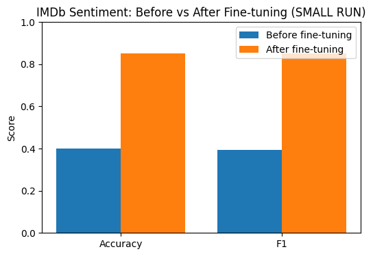
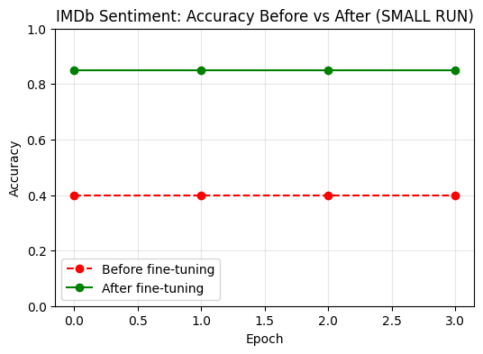

# Head-Only Fine-Tuning with DistilBERT

**IMDb binary sentiment classification by training a new classification head while freezing the pretrained backbone.**

<p align="center"><a href="#contents"></a> &nbsp; <a href="https://huggingface.co/"></a> &nbsp; <a href="https://huggingface.co/datasets/stanfordnlp/imdb"></a> &nbsp; <a href="https://www.python.org/"></a> &nbsp; <a href="LICENSE"></a></p>

<p align="center"><strong><a href="../README.md">Repository overview</a></strong> · <strong><a href="fine_tuning_new_head_addiiton.py">Training script</a></strong> · <strong><a href="LICENSE">MIT License</a></strong></p>

## Contents

- [1. Objective](#1-objective)
- [2. Model, dataset, and labels](#2-model-dataset-and-labels)
- [3. Training design](#3-training-design)
- [4. Training configuration and runtime behavior](#4-training-configuration-and-runtime-behavior)
- [5. Metrics](#5-metrics)
- [6. Result plots](#6-result-plots)
- [7. Inference example](#7-inference-example)
- [8. Files and outputs](#8-files-and-outputs)
- [9. Reproduction checklist](#9-reproduction-checklist)
- [Author](#author)
- [License](#license)


## 1. Objective

This experiment isolates the classification-head adaptation strategy. It loads `distilbert-base-uncased` through Hugging Face Transformers, creates a two-label sequence-classification model, freezes the base Transformer parameters, and updates the newly initialized classification head. The aim is to demonstrate an inexpensive way to attach a task-specific decision layer to a fixed pretrained representation.

## 2. Model, dataset, and labels

| Component | Configuration in the script |
|---|---|
| Pretrained checkpoint | `distilbert-base-uncased` |
| Task | Binary sentiment classification |
| Dataset | Hugging Face `imdb` dataset |
| Training subset by default | 4,000 examples when `SMALL_RUN = True` |
| Test subset by default | 2,000 examples when `SMALL_RUN = True` |
| Labels | `0 = negative`, `1 = positive` |
| Seed | `42` |
| Epochs | `3` |
| Train / evaluation batch size | `16` / `32` |
| Learning rate | `5e-4` |
| Weight decay | `0.0` |
| Metrics | Accuracy and weighted F1 |
| Output directory | `outputs/imdb_head_only/model/` |

With `SMALL_RUN = True`, the dataset splits are shuffled using seed 42 and then selected to the sizes above. Set the flag to `False` to use the complete dataset splits rather than the demo subsets.

## 3. Training design

The workflow proceeds as follows:

1. **Load the data.** `load_dataset("imdb")` loads the train and test splits.
2. **Tokenize reviews.** A fast tokenizer encodes the `text` field with truncation enabled. The original text field is removed after tokenization.
3. **Batch with dynamic padding.** `DataCollatorWithPadding` pads examples to the longest sequence in each batch.
4. **Create a two-class model.** `AutoModelForSequenceClassification.from_pretrained(...)` loads DistilBERT with `num_labels = 2`, including its task-specific classifier.
5. **Freeze the backbone.** The loop sets `requires_grad = False` on parameters in `model.base_model`. The script then prints the names of parameters still trainable; these should correspond to the classifier head.
6. **Measure the baseline.** The Trainer evaluates the randomly initialized head before it is trained. This baseline is expected to be weak and can be near chance, but the exact score should be taken from the actual run.
7. **Train the head.** The Trainer runs three epochs. The configured learning rate is higher than the rates in the partial-backbone and adapter experiments because only the task head is intended to update.
8. **Evaluate and plot.** Accuracy and weighted F1 are compared before and after training. Two plots are generated and displayed.
9. **Save the artifact.** The model and tokenizer are saved to `outputs/imdb_head_only/model/`.

## 4. Training configuration and runtime behavior

The script sets `WANDB_DISABLED = "true"`, uses `report_to="none"`, and calls `set_seed(42)`. It chooses CUDA when `torch.cuda.is_available()` returns true, otherwise CPU. The Trainer enables FP16 when CUDA is available. The default batch sizes are 16 for training and 32 for evaluation, with logging configured every 50 steps.

The first lines of `fine_tuning_new_head_addiiton.py` include `!pip -q install ...`, because the file is exported from a Colab notebook. Run the installation in a notebook cell, or install dependencies separately and remove the notebook-only `!pip` line if executing it as a plain Python script.

### Install dependencies

```bash
pip install -U transformers datasets evaluate accelerate matplotlib torch
```

## 5. Metrics

The code loads the `accuracy` and `f1` metrics from Evaluate. Predictions are generated using the maximum logit index. F1 is calculated with `average="weighted"`, which weights class-specific scores by their support. The printed baseline and post-training metric dictionaries use Trainer keys such as `eval_accuracy` and `eval_f1`.

## 6. Result plots

### Accuracy and F1 before versus after training



### Baseline and final accuracy comparison



The bar chart compares the baseline evaluation with the final evaluation for accuracy and weighted F1. The current line-chart implementation repeats the single baseline accuracy and single final accuracy across the epoch-indexed x-axis; it does **not** record a separate evaluation result at the end of every epoch. Read exact metric values from a current run or the plotted artifact rather than inferring numeric values from descriptive text.

## 7. Inference example

The script defines a `predict(texts)` helper that tokenizes a list of reviews, moves tensors to the selected device, sets the model to evaluation mode, and calculates probabilities under `torch.no_grad()`. For each review it returns:

- the original input text;
- `neg_prob`, the probability assigned to class 0;
- `pos_prob`, the probability assigned to class 1;
- `label`, either `"neg"` or `"pos"` based on the predicted class.

The included demonstration uses a positive review—“This movie was absolutely wonderful. The performances were touching.”—and a negative review—“Boring plot and terrible acting. I want my time back.” The example probabilities in the original project README are illustrative; actual values depend on the trained weights and runtime.

## 8. Files and outputs

```text
NEW_HEAD/
├── README.md
├── fine_tuning_new_head_addiiton.py
├── BAR_CHART.png
└── LINE_CHART.png

# Created after running the script:
outputs/imdb_head_only/model/
```

`trainer.save_model(save_dir)` writes the model configuration and weights; `tokenizer.save_pretrained(save_dir)` writes the tokenizer files. The `outputs/` directory is generated at runtime and is not represented among the tracked files listed above.

## 9. Reproduction checklist

- [ ] Run in a Python/Colab environment with the dependencies installed.
- [ ] Confirm the selected device printed by the script.
- [ ] Confirm `SMALL_RUN` is set to the intended value.
- [ ] Verify the printed trainable parameters correspond to the classification head.
- [ ] Record `eval_accuracy` and `eval_f1` before training.
- [ ] Run training and record the post-training `eval_accuracy` and `eval_f1`.
- [ ] Inspect both generated plots.
- [ ] Confirm the saved model and tokenizer exist in `outputs/imdb_head_only/model/`.


## Explore the other experiments

| Approach | Documentation |
|---|---|
| Head-only classification head | [NEW_HEAD](../NEW_HEAD/README.md) |
| Final Transformer block + head | [LAST_LAYER](../LAST_LAYER/README.md) |
| Low-Rank Adaptation | [PEFT_LORA](../PEFT_LORA/README.md) |
| 4-bit quantized LoRA | [PEFT_QLORA](../PEFT_QLORA/README.md) |

## Author

Shubham Singh


---

## License

This project is licensed under the [MIT License](LICENSE). The full license text is reproduced below; the standalone [`LICENSE`](LICENSE) file is the canonical license file for this directory.

MIT License

Copyright (c) 2026 Shubham Kumar Singh

Permission is hereby granted, free of charge, to any person obtaining a copy
of this software and associated documentation files (the "Software"), to deal
in the Software without restriction, including without limitation the rights
to use, copy, modify, merge, publish, distribute, sublicense, and/or sell
copies of the Software, and to permit persons to whom the Software is
furnished to do so, subject to the following conditions:

The above copyright notice and this permission notice shall be included in all
copies or substantial portions of the Software.

THE SOFTWARE IS PROVIDED "AS IS", WITHOUT WARRANTY OF ANY KIND, EXPRESS OR
IMPLIED, INCLUDING BUT NOT LIMITED TO THE WARRANTIES OF MERCHANTABILITY,
FITNESS FOR A PARTICULAR PURPOSE AND NONINFRINGEMENT. IN NO EVENT SHALL THE
AUTHORS OR COPYRIGHT HOLDERS BE LIABLE FOR ANY CLAIM, DAMAGES OR OTHER
LIABILITY, WHETHER IN AN ACTION OF CONTRACT, TORT OR OTHERWISE, ARISING FROM,
OUT OF OR IN CONNECTION WITH THE SOFTWARE OR THE USE OR OTHER DEALINGS IN THE
SOFTWARE.
