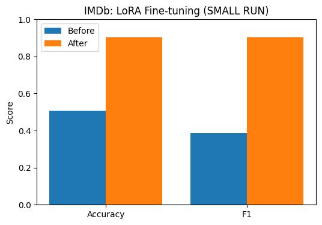
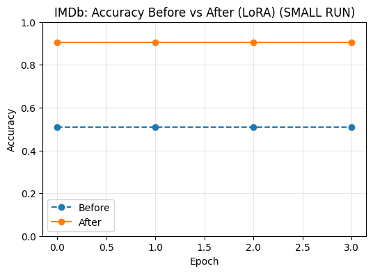

# LoRA Fine-Tuning with Hugging Face PEFT

**Low-Rank Adaptation for binary IMDb sentiment classification using `bert-base-uncased`.** Rather than intentionally updating every pretrained backbone parameter, this experiment wraps a sequence-classification model with PEFT LoRA adapters targeting attention query and value projections.

<p align="center"><a href="#contents"></a> &nbsp; <a href="https://huggingface.co/"></a> &nbsp; <a href="https://huggingface.co/datasets/stanfordnlp/imdb"></a> &nbsp; <a href="https://www.python.org/"></a> &nbsp; <a href="LICENSE"></a></p>

<p align="center"><strong><a href="../README.md">Repository overview</a></strong> · <strong><a href="peft_lora.py">Training script</a></strong> · <strong><a href="LICENSE">MIT License</a></strong></p>

## Contents

- [1. Why this experiment exists](#1-why-this-experiment-exists)
- [2. Model and hyperparameters](#2-model-and-hyperparameters)
- [3. LoRA configuration explained](#3-lora-configuration-explained)
- [4. Training pipeline](#4-training-pipeline)
- [5. Setup and runtime notes](#5-setup-and-runtime-notes)
- [6. Evaluation metrics](#6-evaluation-metrics)
- [7. Result artifacts](#7-result-artifacts)
- [8. Saved model](#8-saved-model)
- [9. Practical considerations](#9-practical-considerations)
- [10. Reproduction checklist](#10-reproduction-checklist)
- [Author](#author)
- [License](#license)


## 1. Why this experiment exists

Full fine-tuning updates the model's pretrained weights. LoRA introduces trainable low-rank updates into selected linear projections and keeps the base weights frozen by the PEFT adapter setup. This changes the training problem from updating the full model to optimizing a much smaller adapter/task-specific parameter set.

The project uses the IMDb movie-review dataset and evaluates accuracy and weighted F1 before and after training. The script also calls `model.print_trainable_parameters()` so the effective trainable-parameter summary is visible in the runtime.

## 2. Model and hyperparameters

| Component | Configuration in the script |
|---|---|
| Base checkpoint | `bert-base-uncased` |
| Task | `TaskType.SEQ_CLS` (sequence classification) |
| Dataset | Hugging Face `imdb` |
| Default subset | 4,000 train / 2,000 test with `SMALL_RUN = True` |
| Random seed | `42` |
| LoRA rank (`r`) | `8` |
| LoRA alpha | `16` |
| LoRA dropout | `0.1` |
| Target module names | `query`, `value` |
| Epochs | `3` |
| Train / evaluation batch size | `16` / `32` |
| Learning rate | `2e-4` |
| Weight decay | `0.01` |
| Metrics | Accuracy and weighted F1 |
| Output directory | `outputs/imdb_lora/model/` |

The README describes the experiment as training approximately 1% of parameters; the script itself prints the actual trainable summary for the loaded model and installed PEFT version. Use that runtime report as the authoritative number for a particular environment.

## 3. LoRA configuration explained

The workflow creates `LoraConfig` with the following key fields:

- `task_type=TaskType.SEQ_CLS`: configures the adapter for sequence classification.
- `r=8`: sets the adapter rank.
- `lora_alpha=16`: sets the scaling parameter used by the LoRA implementation.
- `lora_dropout=0.1`: applies dropout within adapter updates during training.
- `target_modules=["query", "value"]`: selects the attention query and value projection modules by name.

The base model is loaded using `AutoModelForSequenceClassification.from_pretrained(model_name, num_labels=2)` and then wrapped with `get_peft_model(base_model, lora_config)`. Confirm target module names if you change the checkpoint architecture.

## 4. Training pipeline

1. **Initialize environment.** Import PyTorch, Matplotlib, Transformers, Datasets, Evaluate, and PEFT; turn off W&B reporting and set seed 42.
2. **Load IMDb.** Fetch train and test splits. In small-run mode, use seeded shuffling and select 4,000 train and 2,000 test examples.
3. **Tokenize.** Use the fast BERT tokenizer with truncation, remove raw text after mapping, and create a `DataCollatorWithPadding`.
4. **Build the task model.** Load BERT sequence classification with two labels and move it to CUDA when available, otherwise CPU.
5. **Attach LoRA.** Create the config and wrap the classifier with `get_peft_model`.
6. **Inspect trainable parameters.** Print PEFT's parameter summary to confirm the adapter wrapping took effect.
7. **Evaluate baseline.** Run Trainer evaluation before adapter training; the script labels this result “Baseline (LoRA adapters not trained)”.
8. **Train adapters.** Run three epochs with learning rate `2e-4`, train batch 16, evaluation batch 32, weight decay `0.01`, logging every 50 steps, and FP16 if CUDA is available.
9. **Evaluate after training.** Compute accuracy and weighted F1 again.
10. **Plot comparison.** Display before/after metric bars and the baseline/final accuracy line visualization.
11. **Save.** Persist the PEFT model and tokenizer under `outputs/imdb_lora/model/`.

## 5. Setup and runtime notes

```bash
pip install -U transformers datasets evaluate accelerate peft bitsandbytes matplotlib torch
```

`bitsandbytes` is present in the script's installation command and shared repository setup, but the LoRA script does not configure 4-bit loading; that is the specific distinction of the QLoRA experiment.

This file was exported from a Colab notebook and begins with `!pip -q install ...`. That syntax is for an IPython notebook cell. To run as a plain `.py` script, install the packages separately in the shell and remove the notebook magic command. The script prints whether the selected device is CPU or CUDA and the GPU name when available.

Keep `SMALL_RUN = True` for the faster 4,000/2,000 subset. Set it to `False` to use all examples in the dataset's standard train and test splits. The data download, tokenization, and training time will increase accordingly.

## 6. Evaluation metrics

The metric callback predicts with `logits.argmax(axis=-1)` and returns accuracy plus F1 with `average="weighted"`. The baseline and final values are stored in dictionaries with keys `eval_accuracy` and `eval_f1`. The chart generator consumes those values directly; the README does not hardcode a result number because values must match the run and checkpoint being reviewed.

## 7. Result artifacts

### Accuracy and weighted F1



### Baseline and final accuracy comparison



The bar plot contains the baseline and post-training values for accuracy and weighted F1. In the current implementation, the line plot repeats the single baseline evaluation and final evaluation values across an epoch-indexed axis; it does not plot independently measured accuracy for each epoch. The repository's stated qualitative result is a significant improvement in accuracy and F1 after training; refer to the included chart or the saved Trainer output for the actual values.

## 8. Saved model

The script creates `outputs/imdb_lora/model/` through:

```python
trainer.save_model(save_dir)
tokenizer.save_pretrained(save_dir)
```

The folder contains the trained PEFT model artifacts and tokenizer files generated by the current library versions. The output folder is produced at runtime and is not included in the tracked project tree. Preserve it for subsequent inference or deployment experiments.

## 9. Practical considerations

- Verify that the `query` and `value` module names exist in a replacement architecture.
- Keep the model checkpoint fixed when making controlled comparisons between LoRA and QLoRA.
- Record the actual trainable-parameter report, dataset mode, Transformers/PEFT versions, GPU, and final metrics with each result.
- Do not treat the approximately 1% trainable figure or qualitative memory labels as a hardware-independent guarantee; use the runtime values for the actual configuration.
- The plotted line is a baseline/final illustration, not an epoch-wise training curve.

## 10. Reproduction checklist

- [ ] Run in a notebook or Python environment with dependencies installed.
- [ ] Confirm `bert-base-uncased`, IMDb, and `SMALL_RUN` settings.
- [ ] Verify PEFT prints the trainable-parameter summary.
- [ ] Capture baseline and final `eval_accuracy` / `eval_f1`.
- [ ] Inspect both charts.
- [ ] Confirm `outputs/imdb_lora/model/` contains the saved model and tokenizer.


## Explore the other experiments

| Approach | Documentation |
|---|---|
| Head-only classification head | [NEW_HEAD](../NEW_HEAD/README.md) |
| Final Transformer block + head | [LAST_LAYER](../LAST_LAYER/README.md) |
| Low-Rank Adaptation | [PEFT_LORA](../PEFT_LORA/README.md) |
| 4-bit quantized LoRA | [PEFT_QLORA](../PEFT_QLORA/README.md) |

## Author

Shubham Singh


---

## License

This project is licensed under the [MIT License](LICENSE). The full license text is reproduced below; the standalone [`LICENSE`](LICENSE) file is the canonical license file for this directory.

MIT License

Copyright (c) 2026 Shubham Kumar Singh

Permission is hereby granted, free of charge, to any person obtaining a copy
of this software and associated documentation files (the "Software"), to deal
in the Software without restriction, including without limitation the rights
to use, copy, modify, merge, publish, distribute, sublicense, and/or sell
copies of the Software, and to permit persons to whom the Software is
furnished to do so, subject to the following conditions:

The above copyright notice and this permission notice shall be included in all
copies or substantial portions of the Software.

THE SOFTWARE IS PROVIDED "AS IS", WITHOUT WARRANTY OF ANY KIND, EXPRESS OR
IMPLIED, INCLUDING BUT NOT LIMITED TO THE WARRANTIES OF MERCHANTABILITY,
FITNESS FOR A PARTICULAR PURPOSE AND NONINFRINGEMENT. IN NO EVENT SHALL THE
AUTHORS OR COPYRIGHT HOLDERS BE LIABLE FOR ANY CLAIM, DAMAGES OR OTHER
LIABILITY, WHETHER IN AN ACTION OF CONTRACT, TORT OR OTHERWISE, ARISING FROM,
OUT OF OR IN CONNECTION WITH THE SOFTWARE OR THE USE OR OTHER DEALINGS IN THE
SOFTWARE.
