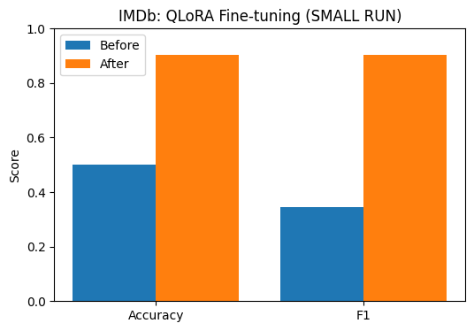
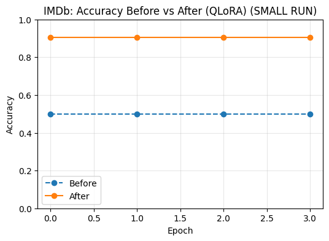

# QLoRA Fine-Tuning with PEFT and 4-Bit NF4 Quantization

**A parameter-efficient IMDb sentiment-classification experiment that combines a quantized base model with LoRA adapters.** The script loads `bert-base-uncased` through Transformers' bitsandbytes quantization configuration, applies LoRA to attention query/value projections, evaluates before and after training, and saves the resulting model artifacts.

## 1. Method overview

QLoRA combines low-bit base-model loading with trainable low-rank adapters. In this repository, the intended efficiency mechanisms are:

1. Load the base sequence-classification model with `load_in_4bit=True`.
2. Use `bnb_4bit_quant_type="nf4"` (NormalFloat4) for quantized weights.
3. Enable `bnb_4bit_use_double_quant=True`.
4. Configure compute dtype as BF16 when CUDA is available and FP32 otherwise.
5. Wrap the quantized model with PEFT LoRA, targeting modules named `query` and `value`.
6. Train with BF16 enabled whenever CUDA is available and FP16 explicitly disabled.

The goal is to reduce the memory cost of keeping the pretrained base weights in full precision while still learning task-specific adapter updates. Effective behavior and compatibility depend on the GPU, driver, PyTorch, Transformers, PEFT, and bitsandbytes versions.

## 2. Configuration reference

| Component | Configuration in the script |
|---|---|
| Base checkpoint | `bert-base-uncased` |
| Dataset | Hugging Face `imdb` |
| Task | Binary sequence classification |
| Demo subset | 4,000 train / 2,000 test with `SMALL_RUN = True` |
| Random seed | `42` |
| Quantization | 4-bit NF4 with double quantization |
| Quantized compute dtype | BF16 if CUDA is available; otherwise FP32 |
| Device placement | `device_map="auto"` |
| LoRA rank | `8` |
| LoRA alpha | `16` |
| LoRA dropout | `0.1` |
| Target modules | `query`, `value` |
| Epochs | `3` |
| Learning rate | `2e-4` |
| Train / evaluation batch size | `16` / `32` |
| Weight decay | `0.01` |
| Training precision flags | `bf16=torch.cuda.is_available()`, `fp16=False` |
| Metrics | Accuracy and weighted F1 |
| Output directory | `outputs/imdb_qlora/model/` |

## 3. Quantization and adapter setup

### 3.1 BitsAndBytes configuration

The script defines `BitsAndBytesConfig` with:

```python
BitsAndBytesConfig(
    load_in_4bit=True,
    bnb_4bit_quant_type="nf4",
    bnb_4bit_compute_dtype=torch.bfloat16 if torch.cuda.is_available() else torch.float32,
    bnb_4bit_use_double_quant=True,
)
```

It then loads `AutoModelForSequenceClassification` with `num_labels=2`, the quantization configuration, and `device_map="auto"`. The code subsequently attaches a LoRA configuration for sequence classification using rank 8, alpha 16, dropout 0.1, and target modules `query` and `value`.

### 3.2 Adapter wrapping

`get_peft_model(base_model, lora_config)` wraps the quantized base model. `model.print_trainable_parameters()` prints the resulting PEFT trainable-parameter summary. Use that output—not only a generic percentage from documentation—when recording the trainable count for the actual model and package versions.

## 4. Training workflow

1. Install or upgrade the training packages.
2. Set seed 42 and disable W&B reporting.
3. Load the IMDb dataset and, by default, shuffle/select 4,000 train and 2,000 test examples for a quick run.
4. Tokenize text with the fast tokenizer and truncation enabled.
5. Load BERT sequence classification in 4-bit NF4 mode with automatic device placement.
6. Add the LoRA adapters to query/value projections.
7. Print the trainable parameter summary.
8. Evaluate the baseline model/adapters before fine-tuning.
9. Train for three epochs with learning rate `2e-4`, batch sizes of 16/32, weight decay `0.01`, BF16 if CUDA is available, and FP16 turned off.
10. Evaluate again using accuracy and weighted F1.
11. Generate the before/after bar chart and baseline/final accuracy plot.
12. Save the PEFT model and tokenizer under `outputs/imdb_qlora/model/`.

## 5. Installation and runtime compatibility

The source script includes notebook-style package installation lines, including upgrades for `bitsandbytes`, `transformers`, `accelerate`, and `peft`. A typical notebook setup is:

```bash
pip install -U bitsandbytes transformers accelerate peft datasets evaluate matplotlib torch
```

The `.py` export contains `!pip` commands, which are valid in Colab/Jupyter cells but not ordinary Python syntax. For a standalone script, install the packages in the terminal and remove those notebook-only lines first.

The code ties both the quantization compute dtype and Trainer's BF16 flag to the availability of CUDA; it does not separately check whether the selected GPU supports BF16. Use a CUDA/runtime combination compatible with the configured quantization and precision flags. If the hardware does not support BF16, adjust the precision configuration deliberately and rerun the experiment rather than assuming all CUDA GPUs behave identically. The non-CUDA fallback chooses FP32 as quantization compute dtype, but 4-bit bitsandbytes execution still has platform and backend constraints; it should not be assumed to operate on CPU-only machines.

For quick experimentation, keep `SMALL_RUN = True`. Set it to `False` to use full dataset splits, recognizing that processing will take longer. The script uses `device_map="auto"` for model placement.

## 6. Metrics and evaluation protocol

The script uses Evaluate's `accuracy` and `f1` metrics. Predictions are formed from the argmax class, and F1 is calculated with `average="weighted"`. It evaluates once before training and once after training, storing results under keys such as `eval_accuracy` and `eval_f1`.

The baseline is not a guarantee of exactly 50% accuracy: the actual value depends on initialized classifier/adapters and the specific runtime. Likewise, the project's description of a significant post-training improvement should be read alongside the actual chart artifact or output from the run being compared.

## 7. Result plots

### Accuracy and weighted F1



### Baseline versus final accuracy



The bar chart compares baseline and post-training accuracy/F1. The code currently generates the line visualization by repeating the two evaluation values across an epoch-indexed x-axis. It is a compact before/after view, not a log of separately evaluated checkpoints at each epoch.

## 8. Artifacts and reuse

After training, the script saves the model and tokenizer under:

```text
outputs/imdb_qlora/model/
```

The output is created at runtime and is not listed among the tracked files in this directory. Retain the generated folder if you need to reload the trained PEFT model in a subsequent workflow. The exported QLoRA script currently does not define the same explicit `predict(texts)` helper as the head-only, last-layer, and LoRA scripts; its demonstrated deliverable is the training/evaluation and artifact-saving flow.

## 9. Practical interpretation

The repository describes QLoRA as reducing memory use through 4-bit quantization (approximately 75% smaller weight storage in the original overview) and training around 1% of parameters through adapters. Treat these as explanatory summaries rather than universal measured guarantees: total runtime memory also includes activations, optimizer state, temporary tensors, and runtime overhead. Hardware, sequence lengths, batch sizes, model architecture, and library implementation affect realized savings.

For a controlled LoRA-versus-QLoRA comparison, keep dataset mode, seed, base checkpoint, epoch count, rank/alpha/dropout, batch sizes, and metric protocol matched where possible; record the differing quantization and precision configuration explicitly.

## 10. Reproduction checklist

- [ ] Install compatible versions of PyTorch, Transformers, PEFT, Accelerate, bitsandbytes, Datasets, and Evaluate.
- [ ] Confirm the active runtime supports the configured 4-bit/BF16 combination.
- [ ] Verify the intended `SMALL_RUN` mode and model checkpoint.
- [ ] Inspect the trainable-parameter summary.
- [ ] Capture baseline and final accuracy/weighted F1.
- [ ] Inspect both plot artifacts.
- [ ] Confirm the model and tokenizer were saved under `outputs/imdb_qlora/model/`.

## Author

Shubham Singh


---

## License

MIT License

Copyright (c) 2026 Shubham Kumar Singh

Permission is hereby granted, free of charge, to any person obtaining a copy
of this software and associated documentation files (the "Software"), to deal
in the Software without restriction, including without limitation the rights
to use, copy, modify, merge, publish, distribute, sublicense, and/or sell
copies of the Software, and to permit persons to whom the Software is
furnished to do so, subject to the following conditions:

The above copyright notice and this permission notice shall be included in all
copies or substantial portions of the Software.

THE SOFTWARE IS PROVIDED "AS IS", WITHOUT WARRANTY OF ANY KIND, EXPRESS OR
IMPLIED, INCLUDING BUT NOT LIMITED TO THE WARRANTIES OF MERCHANTABILITY,
FITNESS FOR A PARTICULAR PURPOSE AND NONINFRINGEMENT. IN NO EVENT SHALL THE
AUTHORS OR COPYRIGHT HOLDERS BE LIABLE FOR ANY CLAIM, DAMAGES OR OTHER
LIABILITY, WHETHER IN AN ACTION OF CONTRACT, TORT OR OTHERWISE, ARISING FROM,
OUT OF OR IN CONNECTION WITH THE SOFTWARE OR THE USE OR OTHER DEALINGS IN THE
SOFTWARE.
